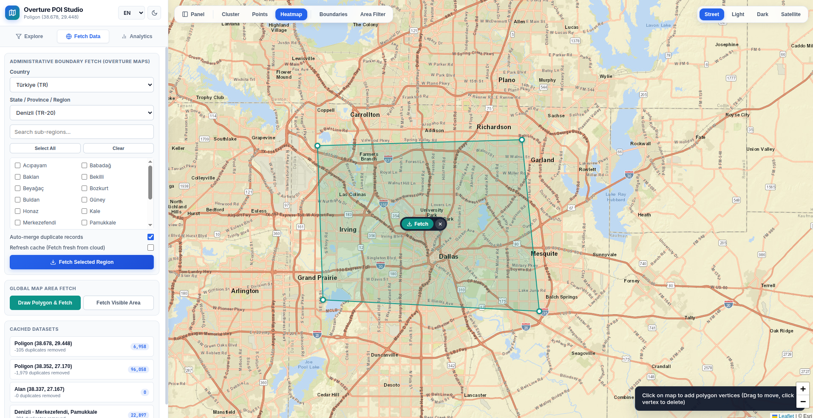
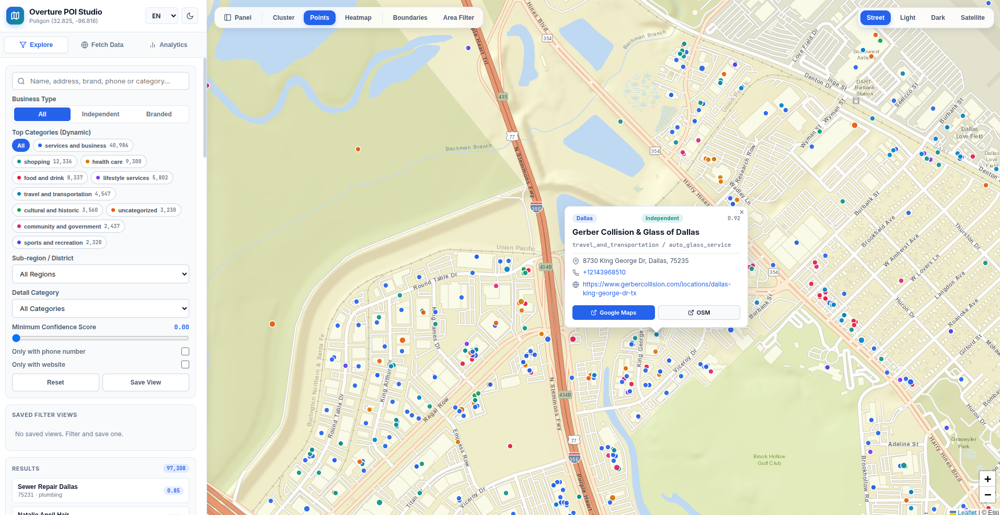

# Overture POI Studio

An interactive geospatial Point of Interest (POI) exploration, extraction, deduplication, and analytics platform powered by Overture Maps Foundation datasets, DuckDB, and FastAPI.

---

## Screenshots

### Interactive Polygon Extraction & Administrative Boundary Fetching
Draw custom polygons anywhere on the map with draggable/deletable vertices and a centered **Fetch** action, or query POIs by country, region, and district boundaries with local dataset caching.

### POI Exploration, Dynamic Filtering & Detail Inspection
Inspect tens of thousands of POIs smoothly with viewport-culled HTML5 Canvas rendering, dynamic category filters, business type segmentation, confidence thresholds, and rich POI detail cards with direct Google Maps and OpenStreetMap links.

---

## Key Features

- **Global Administrative Boundary Querying:** Query POIs across 197 countries by administrative divisions (country, state/province/region, and sub-region/district) with automatic boundary GeoJSON overlays.
- **Interactive Polygon & Bounding Box Extraction:**
  - Draw custom polygons directly on the map with nearest-edge vertex insertion, drag-to-move vertices, click-to-delete vertices, and a centered action button to start extraction.
  - Fetch POIs directly from the current map viewport.
- **Real-Time Streaming Progress:** Streams live record counts via NDJSON (`/api/pois/fetch-stream`) while querying Overture Maps S3 Parquet files through DuckDB (Spatial + HTTPFS).
- **High-Performance Viewport Rendering:**
  - Strictly renders only POIs visible within the current map viewport (viewport culling).
  - Automatically switches between smooth HTML5 Canvas point rendering (up to 1,500 visible POIs) and fast screen-space grid clustering for dense zoomed-out views.
  - Supports Cluster, Points, and Heatmap visualization modes across Street, Light, Dark, and Satellite basemaps.
- **Smart Deduplication:**
  - Matches duplicates using spatial grid + normalized name and phone number + proximity.
  - Retains the highest confidence and richest record while merging missing address, phone, website, and brand fields.
- **Brand & Category Enrichment:** Extracts hierarchical categories (`topCategory`, `basicCategory`, `primaryCategory`) and classifies independent vs. branded businesses.
- **Multi-Language Support (i18n):** Built-in interface localization in English (default), Turkish, Chinese, German, Russian, and Arabic (with RTL layout support).
- **Local Caching & Multi-Format Export:** Caches division boundaries and query datasets locally for instant reload, and exports filtered results to **CSV**, **Excel (`.xlsx`)**, and **GeoJSON (`.geojson`)**.

---

## Architecture & Project Structure

The codebase follows Clean Code and Single Responsibility principles (one class per file):

- `server.py` — Uvicorn application entry point (`http://127.0.0.1:8000`, configurable via `HOST` and `PORT`).
- `Dockerfile` & `docker-compose.yml` — Containerized deployment with pre-installed DuckDB (`httpfs`, `spatial`) extensions and persistent `./cache` and `./output` volumes.
- `src/api_application.py` — FastAPI route definitions, cache-control headers, and static web hosting.
- `src/poi_fetch_coordinator.py` — Coordinates district, polygon, and bounding-box fetch workflows and NDJSON progress streaming.
- `src/overture_release_resolver.py` — DuckDB connection setup and latest Overture Maps S3 release resolution.
- `src/overture_sql_builder.py` — Parameterized spatial SQL builder for Overture divisions and places Parquet tables.
- `src/overture_poi_fetcher.py` — Batched DuckDB query execution with live progress callbacks.
- `src/division_service.py` — Administrative region/district lookup and local JSON boundary caching.
- `src/country_catalog.py` & `src/data/countries.json` — ISO-2 global country catalog and region mappings.
- `src/poi_classifier.py` — Category hierarchy resolution and brand detection.
- `src/poi_deduplicator.py` — Spatial and lexical deduplication and record merging.
- `src/poi_cache_store.py` — Local query dataset cache persistence.
- `src/export_service.py` — CSV, Excel (XLSX), and GeoJSON export generator.
- `web/` — Modular frontend with Leaflet mapping (`poi_layer_renderer.js`, `polygon_draw_controller.js`, `map_controller.js`), filtering, analytics, theme switcher, and i18n (`web/i18n/translations.json`).

---

## Requirements

- Python 3.10+ (or Docker / Docker Compose)
- `duckdb >= 1.1.0`
- `fastapi >= 0.115.0`
- `uvicorn >= 0.32.0`
- `openpyxl >= 3.1.0`

---

## Containerized Deployment (Docker)

The project includes a `Dockerfile`, `.dockerignore`, and `docker-compose.yml` for zero-setup deployment:

- Pre-installs Python dependencies along with DuckDB `httpfs` and `spatial` extensions at build time.
- Exposes the web interface and REST API on port `8000` (`http://localhost:8000`).
- Persists downloaded division boundaries, cached query datasets, and exported outputs via mounted `./cache` and `./output` volumes.

---

## API Endpoints

| Method | Endpoint | Description |
| :--- | :--- | :--- |
| `GET` | `/api/countries` | Returns the global list of supported ISO-2 countries. |
| `GET` | `/api/countries/{country_code}/regions` | Returns states/provinces/regions for the selected country. |
| `GET` | `/api/countries/{country_code}/regions/{region_code}/districts` | Returns sub-regions/districts and their bounding boxes. |
| `GET` | `/api/cache` | Lists locally cached POI datasets. |
| `GET` | `/api/cache/{cache_key}` | Loads a cached dataset by key. |
| `GET` | `/api/pois/initial` | Loads the initial workspace dataset. |
| `POST` | `/api/pois/fetch` | Fetches POIs by districts, custom polygon, or bounding box. |
| `POST` | `/api/pois/fetch-stream` | Streams live progress counts and final POI payload as NDJSON. |
| `POST` | `/api/pois/export` | Exports filtered POI items as `csv`, `xlsx`, or `geojson`. |
